# SPI Master and Slave in SystemVerilog

**[View the full SPI documentation on Canva](https://canva.link/spi-part-one)**

**Author: Amr El Kamash**

A hardware implementation of SPI master and slave cores with support for all four SPI modes, selectable bit order, and an 8-bit application interface. The master generates the serial clock and chip-select signals, while the slave follows the externally supplied clock and selection signals.

The design supports full-duplex transfers and consecutive bytes within a transaction. This README explains the architecture, transmit/receive handshakes, timing, and FPGA prototype documented in **SPI Project - Part One**.

## Contents

- [Features](#features)
- [Interfaces](#interfaces)
- [Configuration](#configuration)
- [Master Architecture](#master-architecture)
- [Slave Architecture](#slave-architecture)
- [SPI Modes](#spi-modes)
- [Transfer Timing](#transfer-timing)
- [Multiple Slave Selection](#multiple-slave-selection)
- [FPGA Prototype](#fpga-prototype)
- [Verification and Documentation Status](#verification-and-documentation-status)
- [Integration Notes](#integration-notes)

## Features

- Separate SystemVerilog master and slave cores.
- Full-duplex serial communication through MOSI and MISO.
- All four combinations of clock polarity (`CPOL`) and phase (`CPHA`).
- Selectable LSB-first or MSB-first transmission.
- 8-bit transmit and receive data paths in the documented implementation.
- Transmit interface using `TX_BYTE`, `TX_VALID`, and `TX_READY`.
- Receive interface using `RX_BYTE` and `RX_VALID`.
- Master clock-division parameter and configurable number of chip-select outputs.
- Consecutive transfers with chip select held active.
- Mode-dependent transaction completion and chip-select hold handling.

## Interfaces

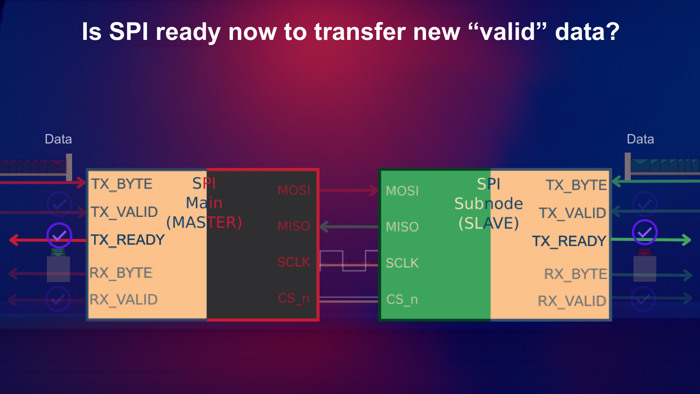

*The application provides parallel transmit data and receives parallel output data. The cores serialize and reconstruct that data across the SPI link. Source: PDF page 48.*

### SPI Bus

| Signal | Master direction | Slave direction | Purpose |
| --- | --- | --- | --- |
| `MOSI` | Output | Input | Master-to-slave serial data |
| `MISO` | Input | Output | Slave-to-master serial data |
| `SCLK` | Output | Input | Serial clock generated by the master |
| `CS_n` | Output | Input | Active-low slave selection |

The master owns transaction timing. The selected slave participates whenever `CS_n` is active and clock edges arrive, including when its application has not supplied valid transmit data.

### Application Interface

| Signal | Direction relative to each core | Purpose |
| --- | --- | --- |
| `TX_BYTE[7:0]` | Input | Parallel data to transmit |
| `TX_VALID` | Input | Indicates that transmit data is valid |
| `TX_READY` | Output | Indicates a transmit-data loading opportunity |
| `RX_BYTE[7:0]` | Output | Reassembled received byte |
| `RX_VALID` | Output | Indicates that the received byte is complete and valid |
| `TX_SEL` | Input to master only | Selects the target peripheral |

The documented master also uses a system clock, `clk`, and an active-low asynchronous reset, `rst_n`. The slave datapath uses SPI clock edges and chip select as described below.

These are native application signals. The PDF does not describe an APB register interface.

## Configuration

The master RTL excerpt shows the following module parameters:

| Parameter | Shown default | Purpose |
| --- | --- | --- |
| `CPHA` | `0` | Selects clock phase |
| `CPOL` | `0` | Selects idle clock polarity |
| `LSB` | `1` | `1`: LSB first; `0`: MSB first |
| `PERIPHERAL_NO` | `1` | Number of master chip-select outputs |
| `DIV` | `2` | Controls serial-clock and operation-event timing relative to the system clock |

The excerpt defines `DATA_WIDTH = 8` as a **local parameter**, rather than exposing it as a module parameter. It derives `SEL_WIDTH` using `$clog2(PERIPHERAL_NO + 1)`. Match the RTL's actual selection encoding when driving `TX_SEL`.

View the annotated master configuration and RTL interface

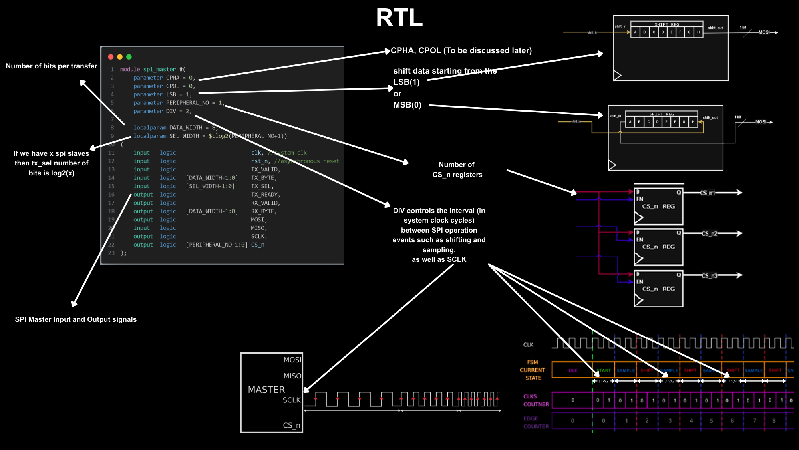

*Annotated configuration from PDF page 86. Clock mode and bit order are module parameters in the shown RTL.*

## Master Architecture

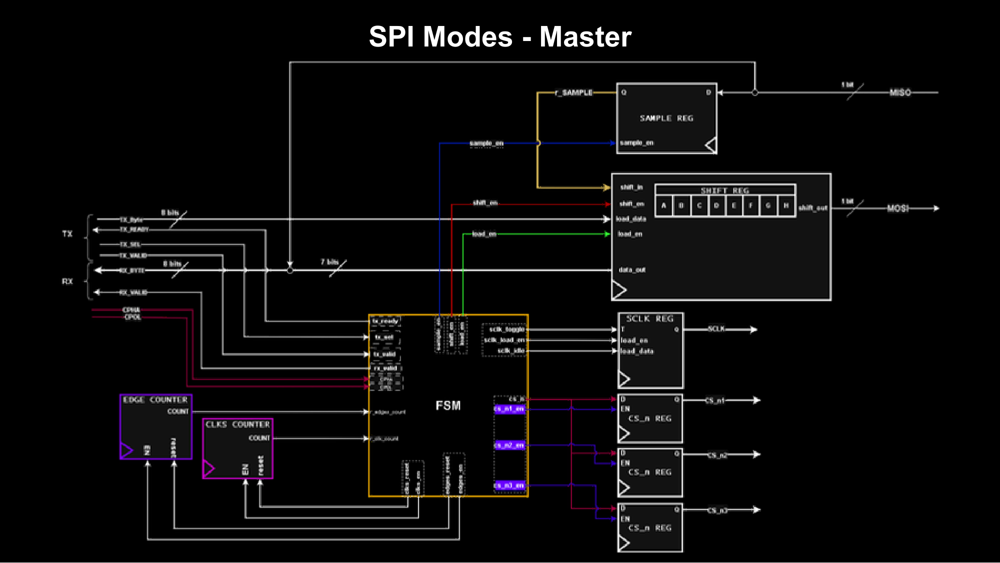

*Master architecture from PDF page 136. The controller drives the datapath, counters, serial clock, and chip-select registers.*

| Block | Role |
| --- | --- |
| Shift register | Loads `TX_BYTE`, sends bits on MOSI, and shifts in sampled receive data |
| Sample register | Captures the incoming MISO bit at the sampling event |
| Clock counter | Times operation events relative to the system clock |
| Edge counter | Tracks progress through the byte transfer |
| FSM | Sequences loading, sampling, shifting, and transaction completion |
| SCLK register | Generates serial-clock transitions and loads the configured idle polarity |
| Chip-select registers | Activate the selected slave and release it after transaction completion |

### Controller States

| State | Purpose |
| --- | --- |
| `IDLE` | Wait for valid data and hold the bus in its idle condition |
| `START` | Load the transmit byte and begin the transfer sequence |
| `PHASE` | Provide the initial phase adjustment for `CPHA = 1` |
| `SAMPLE` | Sample an incoming serial bit |
| `SHIFT` | Advance the transmit/receive shift register |
| `CS_HOLD` | Keep selection active during the documented end-of-transaction hold interval for `CPHA = 0` |

When another valid byte is available at the documented completion boundary, the master can begin the next transfer without releasing chip select. Otherwise, it completes the mode-dependent ending sequence and returns to `IDLE`.

## Slave Architecture

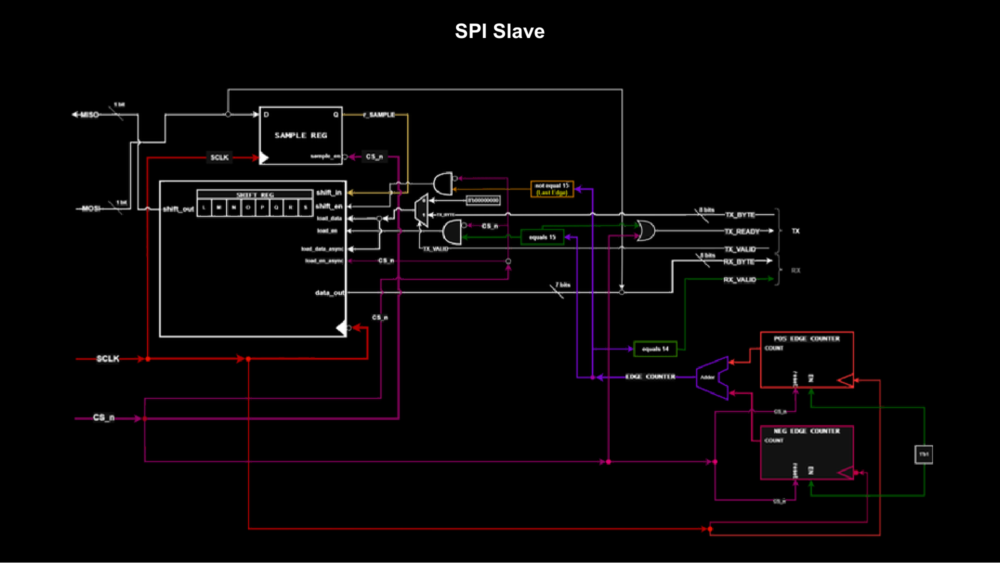

*Slave architecture from PDF page 120. This figure shows the baseline datapath before the later mode-specific discussion.*

The slave uses the master's `SCLK` and `CS_n` to determine when to operate. It does not generate either signal and does not need the master's system-clock timing counter or sequencing FSM.

The documented slave includes:

- A shift register for MISO transmission and received-data reconstruction.
- A sample register for incoming MOSI data.
- Positive-edge and negative-edge counters whose combined count tracks transfer progress.
- Logic that selects loading, shifting, and receive-valid events according to the selected SPI mode.

For the baseline `CPHA = 0` case, chip-select assertion provides the initial loading event before serial clock edges begin. Later bytes load at the documented transfer boundary. The phase-specific logic adjusts these events when `CPHA = 1`.

If the slave has no valid transmit byte, the documented implementation loads zeros and continues participating in the master-controlled transaction.

## SPI Modes

`CPOL` sets the idle level of SCLK. `CPHA` determines whether data is sampled on the leading or trailing edge. The leading edge is the first transition away from the idle level.

| Mode | CPOL | CPHA | SCLK idle | Sample edge | Shift/update edge |
| --- | --- | --- | --- | --- | --- |
| 0 | 0 | 0 | Low | Rising | Falling |
| 1 | 0 | 1 | Low | Falling | Rising |
| 2 | 1 | 0 | High | Falling | Rising |
| 3 | 1 | 1 | High | Rising | Falling |

For `CPHA = 0`, the first transmit bit is available before the first sampling edge. For `CPHA = 1`, the first clock edge establishes the first bit and sampling follows on the next edge.

### Phase-Dependent Master Sequencing

| `CPHA = 0` | `CPHA = 1` |
| --- | --- |
| 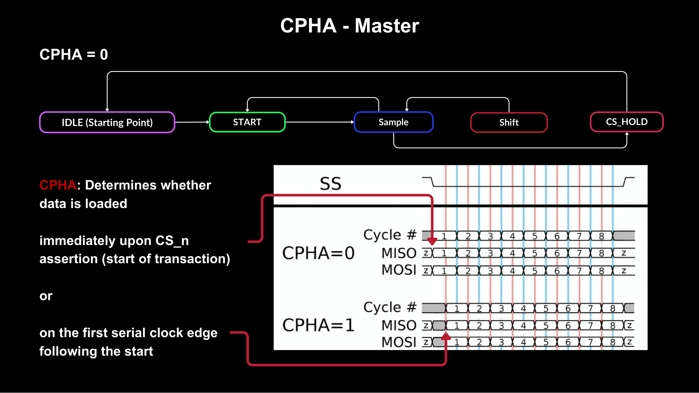 | 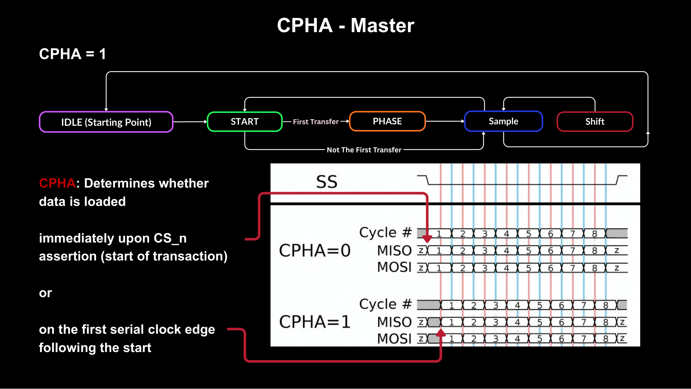 |
| The documented sequence uses `CS_HOLD` when ending the transaction. | The initial transfer uses `PHASE` to delay the first sample. The documented sequence ends without `CS_HOLD`. |

*Phase-specific state sequences from PDF pages 134-135. These diagrams describe this implementation's controller.*

## Transfer Timing

### Full-Duplex Operation

Every byte transfer sends and receives data concurrently. The master transmits on MOSI while sampling MISO. The slave transmits on MISO while sampling MOSI, using the edges selected by the configured mode.

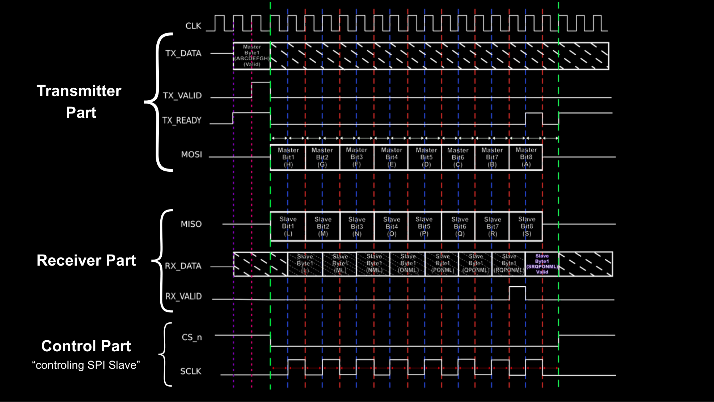

*Transmit, receive, and control waveforms from PDF page 50.*

### Transmit Handshake

For the master, valid transmit data and readiness initiate a transfer. While the current byte is in progress, the controller prevents a new load from overwriting the active shift-register contents. `TX_READY` indicates when another byte can be supplied.

For the slave, readiness identifies loading opportunities, but `TX_VALID` does not control whether a bus transaction proceeds. The master controls that through `CS_n` and `SCLK`.

View the annotated transmit-readiness waveform

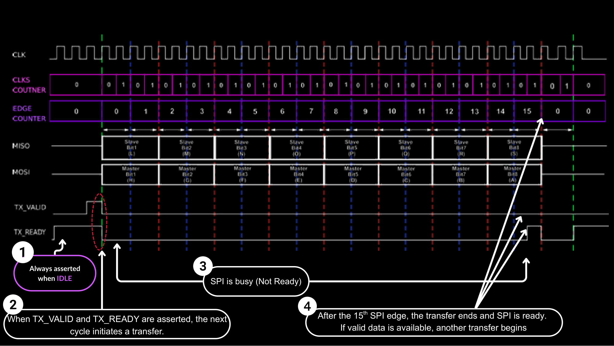

*Annotated loading and completion boundaries from PDF page 71.*

### Consecutive Transfers

A **transfer** exchanges one byte. A **transaction** spans the interval during which chip select remains active and may contain several transfers.

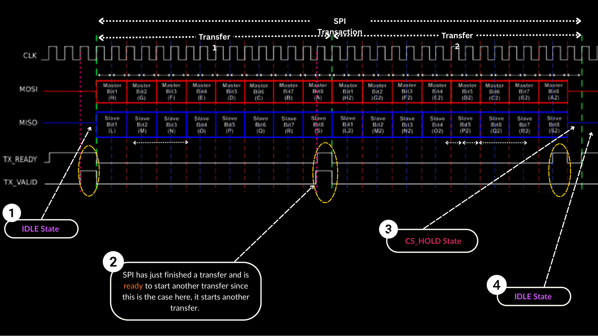

*PDF page 53 shows a second transfer beginning while the same transaction remains active.*

### Receive Completion

`RX_VALID` indicates that all bits of the received byte are available on `RX_BYTE`. In the illustrated baseline master datapath, the final incoming bit is combined directly with the previously collected bits to produce the complete byte at the final sampling event.

View the final-bit receive datapath

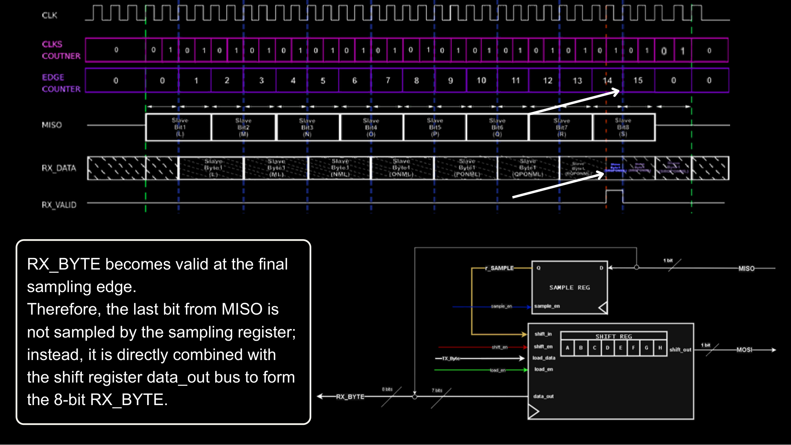

*Receive-completion detail from PDF page 64. The edge numbering shown belongs to the illustrated baseline timing.*

### Chip-Select Hold Interval

For the documented `CPHA = 0` ending sequence, the master holds `CS_n` active for an additional half serial-clock cycle after the final shift edge. This separates the slave's edge-triggered activity from chip-select deassertion.

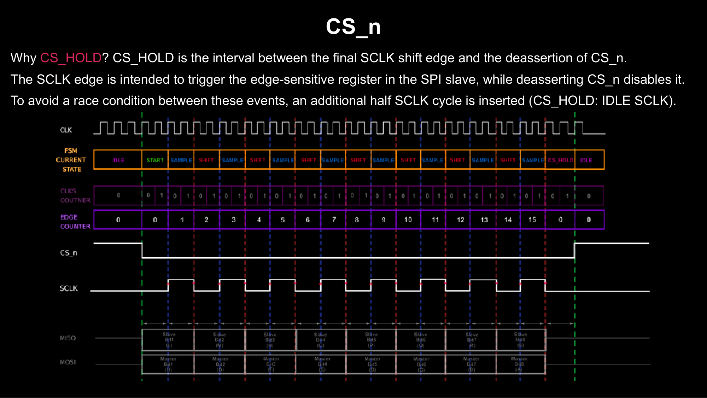

*The implementation's `CS_HOLD` timing, illustrated on PDF page 80.*

## Multiple Slave Selection

The master can expose multiple active-low chip-select outputs. `TX_SEL` chooses the peripheral for communication, while the corresponding chip-select register activates that device.

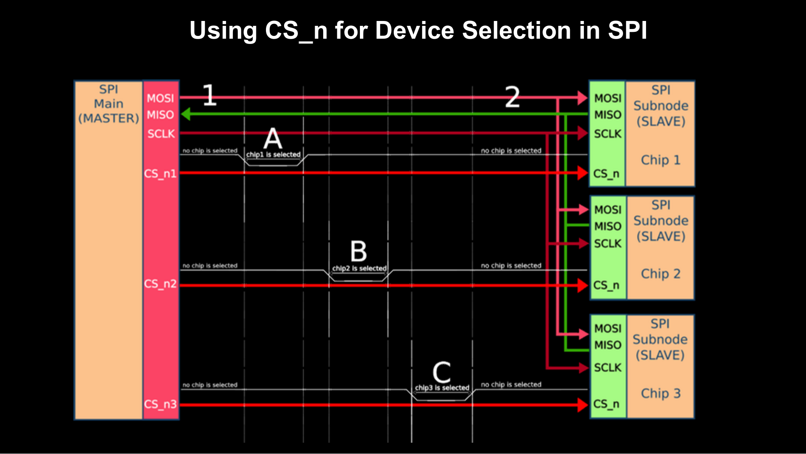

*Peripheral-selection example from PDF page 84. The diagram explains selection topology. Shared-MISO electrical behavior must follow the connected devices' output-enable implementation.*

## FPGA Prototype

The PDF includes a photograph of the FPGA setup with wired connections between the SPI master and slave ports.

  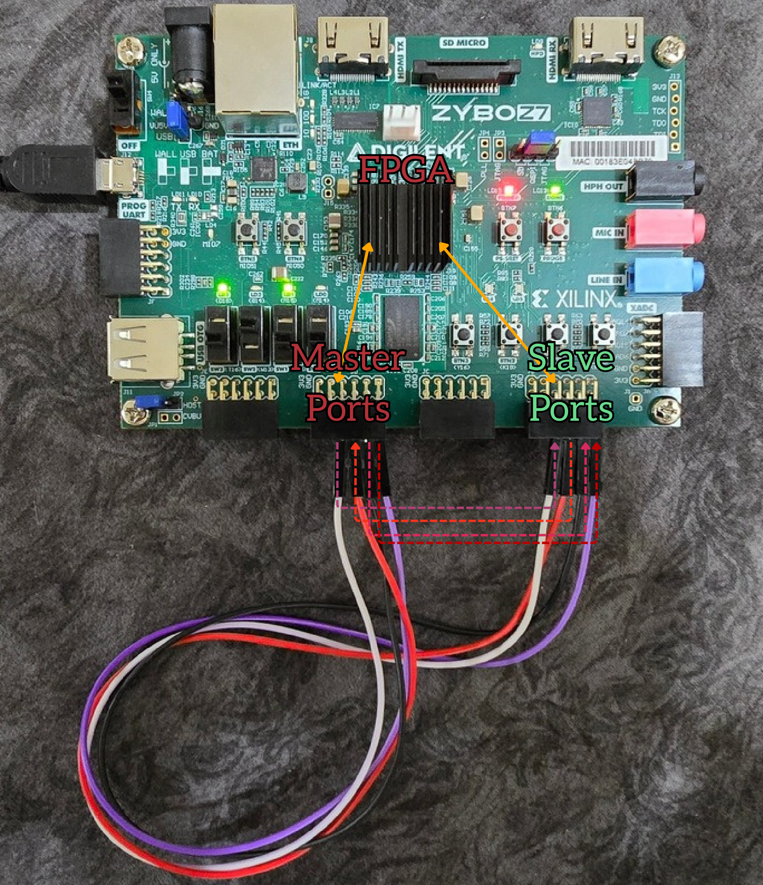

*Prototype photograph from PDF page 10.*

The presentation reports transferring **512 megabits in 30 seconds over 30 cm wires**. This corresponds to approximately **17.1 Mbit/s** when treating “megabits” as decimal units. This is a reported demonstration figure; the PDF does not provide enough measurement detail to distinguish raw serial-clock rate from application throughput or establish a maximum operating rate.

## Verification and Documentation Status

The supplied PDF documents the architecture, mode-dependent behavior, timing illustrations, and FPGA prototype. Its final page introduces verification as a continuation.

Completed UVM verification, coverage results, and cross-IP compatibility results are therefore not claimed here. The waveform figures explain the documented behavior rather than serving as a regression or coverage report.

## Integration Notes

1. Configure the master and slave for matching `CPOL`, `CPHA`, and bit order.
2. Connect MOSI, MISO, SCLK, and the selected active-low chip select, together with a common electrical reference on hardware.
3. Drive the native transmit interface at the loading opportunities indicated by `TX_READY`.
4. Consume `RX_BYTE` when `RX_VALID` indicates valid received data.
5. Match the master's peripheral-selection encoding and clock-division settings to the accompanying RTL.

Compilation order, testbench commands, pin constraints, and FPGA programming steps depend on the repository source and build files. The supplied PDF does not specify reproducible commands for those steps.

---

Documentation and figures adapted from **SPI Project - Part One**, by **Amr El Kamash**. Page references identify the corresponding pages in the supplied PDF.
